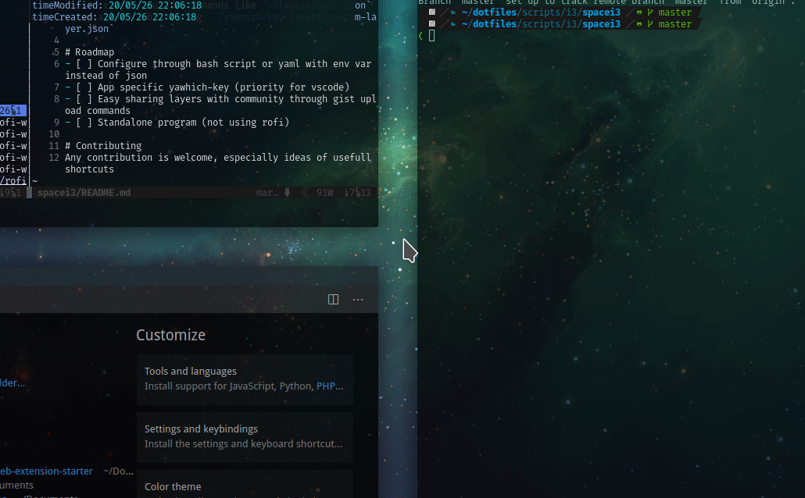

# yawhich-key

A which-key like keybinding helper for macOS - Emacs-style command discovery for your desktop.



yawhich-key displays available keybindings in a popup window, making it easy to discover and remember keyboard shortcuts for your applications and workflows.

## ✨ Features

- 🚀 **Fast & Native** - Built with Tauri + React for minimal resource usage
- 🎨 **Customizable Themes** - Support for custom CSS themes
- 🔍 **Fuzzy Search** - Press `/` to quickly search through commands
- 🎯 **Major Mode** - Application-specific keymaps based on active app
- 🔒 **Hydra Mode** - Keep menu open for repeated command execution
- ⚡ **Smooth Animations** - Beautiful transitions (can be disabled)
- 📝 **YAML Configuration** - Easy-to-read configuration format

## 📦 Installation

### Homebrew (Recommended)

```bash
brew tap adelin-b/yawhich-key
brew install yawhich-key
```

### DMG Installer

Download the latest DMG from [Releases](https://github.com/adelin-b/yawhich-key/releases) and drag to Applications.

### Build from Source

See [INSTALL.md](INSTALL.md) for detailed build instructions.

## 🚀 Quick Start

### 1. Configure

Create your config directory and core layer:

```bash
mkdir -p ~/.config/yawhich-key/layers
cat > ~/.config/yawhich-key/layers/core.yaml << 'EOF'
name: Core Keybindings

keymaps:
  +apps:
    +browser: open -a "Safari"
    +terminal: open -a "Terminal"
    +editor: open -a "Visual Studio Code"

  +window:
    +close: osascript -e 'tell application "System Events" to keystroke "w" using command down'
    +minimize: osascript -e 'tell application "System Events" to keystroke "m" using command down'

  +system:
    +sleep: pmset sleepnow
    +lock: /System/Library/CoreServices/Menu\ Extras/User.menu/Contents/Resources/CGSession -suspend
EOF
```

### 2. Launch

```bash
# Run the app (it stays in background)
yawhich-key

# Or launch from Applications
open /Applications/yawhich-key.app
```

### 3. Use

The app responds to global shortcuts (configure these with your shortcut manager):
- Show general shortcuts
- Show app-specific shortcuts (major mode)

Once open:
- **Type any key** to execute or navigate
- **/** - Search mode
- **H** - Toggle Hydra mode
- **Escape** - Close

## 📖 Documentation

- [Installation Guide](INSTALL.md) - Detailed installation instructions
- [Scripts Guide](SCRIPTS.md) - NPM scripts for building and releasing
- [Release Guide](RELEASE.md) - For maintainers
- See the old README: [README-OLD.md](README-OLD.md)

## 🔧 Configuration

Create `~/.config/yawhich-key/settings.yaml`:

```yaml
animations: true
theme: "custom-theme"  # optional
```

### Custom Themes

Create `~/.config/yawhich-key/themes/custom-theme.css`:

```css
:root {
  --bg-color: rgba(26, 26, 26, 0.95);
  --text-color: #e0e0e0;
  --accent-color: #ff0044;
}
```

### Major Mode (App-specific keymaps)

Create layer files named after app bundle IDs:

`~/.config/yawhich-key/layers/Code.yaml` (for VS Code):
```yaml
name: Visual Studio Code Commands

keymaps:
  +file:
    +new: osascript -e 'tell application "System Events" to keystroke "n" using command down'
    +save: osascript -e 'tell application "System Events" to keystroke "s" using command down'
```

## 🤝 Contributing

Contributions are welcome! Please feel free to submit issues or pull requests.

## 📝 License

See [LICENSE](LICENSE) for details.

## 🙏 Acknowledgments

Inspired by [Emacs which-key](https://github.com/justbur/emacs-which-key), [Spacemacs](https://www.spacemacs.org/), and [Doom Emacs](https://github.com/doomemacs/doomemacs).
